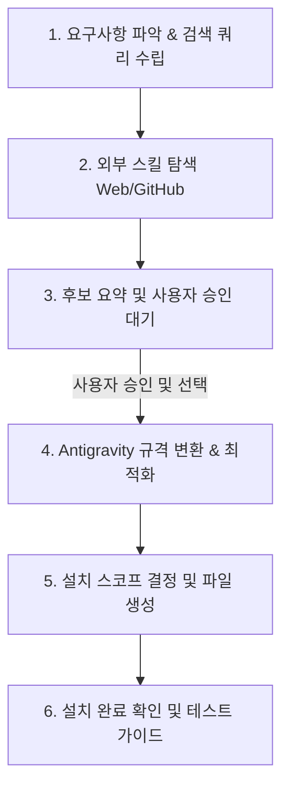

# Find Skill (외부 스킬 탐색 및 적용)

사용자가 필요로 하는 기능이나 작업 프로세스를 듣고, GitHub, 웹, 커뮤니티 등에서 검증된 스킬/프롬프트/규칙을 탐색하여 Antigravity 환경에 맞게 변환·설치하는 스킬입니다.

---

## 작업 절차 (Workflow)



### Step 1. 요구사항 파악 및 검색 쿼리 수립
1. 사용자가 원하는 기능, 대상 프레임워크/언어, 작업 성격을 분석합니다.
2. 효과적인 검색 쿼리를 구성합니다.
   * 주요 탐색 소스 및 검색 전략은 `references/sources.md`를 참고합니다.
   * 예: `site:github.com "SKILL.md" <키워드>`, `site:github.com/sickn33/agentic-awesome-skills <키워드>`

### Step 2. 외부 스킬 탐색 (GitHub & Web Search)
1. `search_web` 도구를 사용하여 GitHub 커뮤니티 저장소(예: `agentic-awesome-skills`, `antigravity-skills`) 및 웹을 검색합니다.
2. 검색된 링크 중 유망한 소스가 있다면 `read_url_content`를 통해 원본 스킬 문서(`SKILL.md`, `CLAUDE.md`, `.cursorrules`, 프롬프트 등)를 확인합니다.
3. 최소 2~3개의 유효한 후보를 선별합니다.

### Step 3. 후보 요약 및 사용자 승인 대기
발견한 후보들을 비교 표 또는 요약 카드로 정리하여 사용자에게 제시합니다:

```markdown
### 🔍 탐색된 스킬 후보

| 후보 | 스킬명 | 주요 특징 및 기능 | 출처 링크 |
| :--- | :--- | :--- | :--- |
| **A (추천)** | `<skill-a>` | <주요 기능 및 왜 추천하는지> | [GitHub](url) |
| **B** | `<skill-b>` | <다른 방식의 접근 또는 간결한 버전> | [GitHub](url) |

*어떤 스킬을 내 환경에 맞게 변환하여 설치할까요? (또는 수정 요청)*
```

> [!IMPORTANT]
> 사용자가 특정 후보를 선택하거나 승인하기 전까지는 로컬 파일 생성을 진행하지 마십시오.

### Step 4. Antigravity 규격 변환 및 최적화
사용자가 승인한 스킬을 Antigravity 표준 `SKILL.md` 형식으로 변환합니다:
1. **YAML Frontmatter 작성**:
   * `name`: 소문자, 하이픈(`-`) 조합의 간결한 식별자.
   * `description`: 해당 스킬이 언제 트리거되어야 하는지 명확하고 구체적으로 작성 (모델이 상황에 맞춰 놓치지 않고 실행하도록 적극적인 설명 포함).
2. **Progressive Disclosure 원칙 적용**:
   * 본문은 500줄 이내로 핵심 작업 절차(Workflow)와 체크리스트 위주로 작성.
   * 복잡한 참조 문서나 예제는 `references/` 하위로 분리.
3. **도구 매핑**:
   * 원본 스킬에 특정 플랫폼 전용 도구가 명시되어 있다면, Antigravity 표준 도구(`run_command`, `replace_file_content`, `grep_search`, `write_to_file`, `schedule` 등)에 맞게 가이드라인을 조정.
4. **출처 명시**:
   * `SKILL.md` 하단에 원작자 저장소 링크 및 라이선스/크레딧을 명시.

### Step 5. 설치 스코프 결정 및 파일 생성
1. **설치 위치 판별 (프로젝트 로컬 기본 원칙)**:
   * **기본값 (Default)**: 현재 작업 중인 프로젝트 디렉터리의 로컬 스코프 (`<프로젝트_루트>/.agents/skills/<skill-name>/SKILL.md`)
   * **사용자가 "전역" 또는 "global"을 명시한 경우에만**: `~/.gemini/config/skills/<skill-name>/SKILL.md`
   * **주의**: 사용자 홈 디렉터리(`C:\Users\<User>\.agents\`)를 프로젝트 폴더로 착각하거나, "어디서든 쓰게 하겠다"며 전역과 로컬에 중복 복사하는 행위를 절대 금지합니다.
   * 작업 대상 프로젝트 위치가 불명확한 경우, 전역으로 임의 폴백하지 말고 사용자에게 프로젝트 경로를 확인하십시오.
2. `write_file` 도구를 사용하여 스킬 파일 및 부속 디렉터리(`references/` 등)를 생성합니다.

### Step 6. 설치 완료 확인 및 테스트 가이드
1. 설치 완료 후 생성된 절대 경로를 사용자에게 안내합니다.
2. 사용자가 방금 설치된 스킬을 즉시 테스트해볼 수 있도록 **테스트 프롬프트 예시 1~2개**를 제공합니다.
